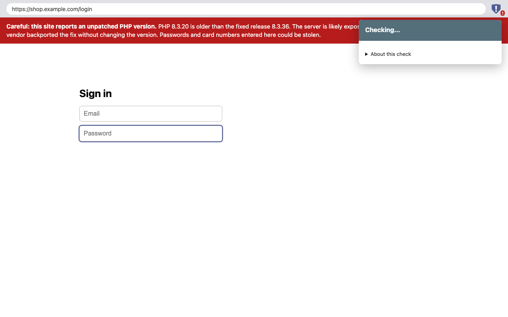

# PHP2Shell Site Check

A browser extension for Chrome and Firefox that warns you when a website's server reports a PHP version vulnerable to **PHP2Shell** (CVE-2026-109618 and CVE-2026-109619).

PHP2Shell is a pair of flaws in the PHP interpreter itself, disclosed on 21 October 2026. These flaws can allow unauthenticated remote code execution on affected PHP deployments. A compromised server can leak what visitors type into it (passwords, card numbers, session tokens) and can serve them malware. Fixed releases are **8.5.12, 8.4.27, 8.3.36 and 8.2.35**. Every branch older than 8.2 is end-of-life and has no fix.



## What it does

- Reads the response headers your browser already receives for each page: `X-Powered-By`, `Server`, `Set-Cookie` (`PHPSESSID`), `X-Pingback`, `Link` (`wp-json`), plus `.php` URLs. It also reads same-origin API and frame responses, which often reveal PHP when the HTML hides it.
- Puts a badge on the toolbar icon:

  | Badge | Meaning |
  |---|---|
  | **!** red | The server reports a PHP version older than the fix. It is likely exposed. |
  | **?** orange | The version predates the fix, but the server looks like a Linux distribution build (Ubuntu, Debian, RHEL…). Distributions often backport fixes without changing the version number, so it may be patched. |
  | **PHP** olive | The site runs PHP but hides its version. Its patch status can't be determined. |
  | **ok** green | The reported version includes the fix. |
  | none | No sign of PHP. |

- On red and orange sites, shows a one-time banner when you start typing into a password or card-number field.
- The popup lists exactly which headers led to the verdict.

## What it does not do

- **It never sends a request of its own.** It does not probe or scan servers. Testing whether someone else's server is exploitable would mean attacking it.
- It processes page addresses, selected response-header evidence, and sensitive-field focus locally to provide the badge and warning. It never reads typed form values or sends this data to the developer or third parties. Tab state stays in the browser's in-memory session storage and is cleared when the tab closes or the browser exits. See [PRIVACY.md](PRIVACY.md).

## Limits, honestly

- Most well-run sites hide their PHP version, so they show as "PHP, version hidden".
- Distribution builds may be patched under an old version number (the orange "?").
- A server can lie in its headers, and a CDN or proxy can strip or rewrite them.
- Pages served entirely by a service worker carry no headers the extension can see. In a tab that already visited the site, the last verdict for that site is reused. Prerendered pages that are activated rely on the in-page script reporting the switch; this path is not covered by automated tests.

Treat the badge as a hint, not proof. If you run a PHP site, patch it: [CISA alert](https://www.cisa.gov/news-events/alerts/2026/10/21/critical-vulnerabilities-php-require-immediate-patching).

## Install

- Chrome Web Store: submission being prepared (item ID `kkpgampikonaiekpmoabbmffnkbbplaj`)
- Firefox Add-ons: [addons.mozilla.org/firefox/addon/php2shell-site-check](https://addons.mozilla.org/firefox/addon/php2shell-site-check/) (in review)
- From source: `npm run build`, then load `dist/chrome` via `chrome://extensions` (Developer mode → Load unpacked), or `dist/firefox/manifest.json` via `about:debugging` → This Firefox → Load Temporary Add-on.

## Develop

```bash
npm install
npm test               # unit tests for the version logic
npm run build          # dist/chrome, dist/firefox and store zips
npm run e2e            # Chromium end-to-end (Playwright)
npm run e2e:firefox    # Firefox end-to-end (needs Firefox and geckodriver)
```

`src/verdict.js` holds the fixed-version table and all classification rules. Update `FIXED_PATCH` there if PHP ships further fixes.

## License

MIT
